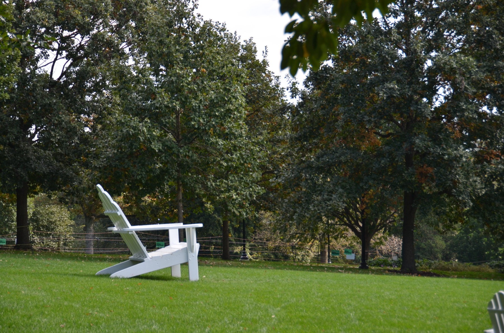

# Ava Gizzie Photography

A one-page, scrolling photography portfolio written in plain HTML, CSS and JavaScript. It has no build step and needs no packages to install.

## Files

```
website/
├── index.html          all page content: sections, photos, captions
├── css/style.css       colors, fonts, layout and grids
├── js/main.js          photo lightbox and nav highlighting
├── images/             web-sized copies of the photos (about 1800px wide)
└── tools/resize-photo.sh   makes a web-sized copy of a new photo
```

Your full-size originals stay in the folders next to `website/` (News, Sports Photography, and so on). They aren't part of this repo.

## Previewing

- **Quickest:** double-click `index.html` to open it in your browser.
- **With live reload in VS Code:** install the recommended **Live Server** extension (VS Code offers it when you open this folder). Then right-click `index.html` and choose **Open with Live Server**. The page reloads every time you save.

## Common edits

### Add a photo

1. Make a web-sized copy:
   ```bash
   tools/resize-photo.sh "../Sports Photography/My New Photo.JPG" sports--my-new-photo
   ```
   This saves `images/sports--my-new-photo.jpg` and prints a ready-to-paste `<figure>` block.
2. Paste that block into the right section of `index.html` and edit the caption and `alt` text.
3. Update the photo count in that section's header (for example, `<span>14 photos</span>`).

Each photo looks like this:

```html
<figure class="c3">
  <button class="frame" style="--ar:1800/1192">
    
  </button>
  <figcaption><span class="dl">Title.</span> Caption text. Oct. 5, 2026.<span class="exif">1/250 · f/5 · ISO 125 · 75mm</span></figcaption>
</figure>
```

- `alt` describes the photo for screen readers and search engines.
- `--ar` is the photo's width/height. It matters only in layouts that show the whole photo uncropped (the photo essay, the self-portrait row, and the lead sports photo).
- To choose which part of a cropped photo stays visible, add `style="object-position: 50% 30%"` to the ``. The first number is the horizontal position and the second is the vertical.

### Change how wide a photo is

Every section uses a grid. The class on each `<figure>` sets how many columns it spans:

| Grid | Classes |
|---|---|
| `g12` (News, More portraits) | `c3` = quarter, `c4` = third, `c8` = two-thirds |
| `g6` (Sports, Artist of the Week, Features, Personal) | `c2` = third, `c3` = half, `c6` = full width |

Make each row add up to the full width (12 or 6 columns) so no photo sits alone in a row. On tablets and phones, the grids switch to two columns and then one, automatically.

### Change colors or fonts

Change the variables at the top of `css/style.css` (`--bg`, `--fg`, `--display`, `--body`). The dark-mode colors are in the two blocks right below them.

### Add or remove a section

Each section is a `<section id="...">` in `index.html`. If you add or remove one, also add or remove its link in the `<nav>` at the top. The link's `href="#id"` must match the section's `id`.

## Still to replace

These are marked with gray "Sample" labels on the page:

- Photo essay title and intro
- The Video section (no video yet)
- The three blog posts
- Bio and contact details in About
